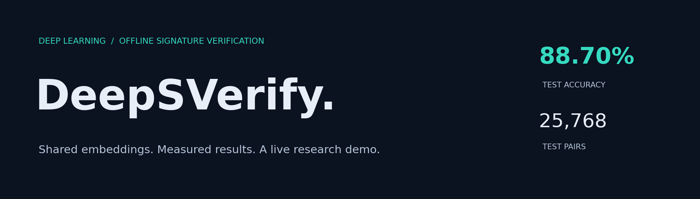
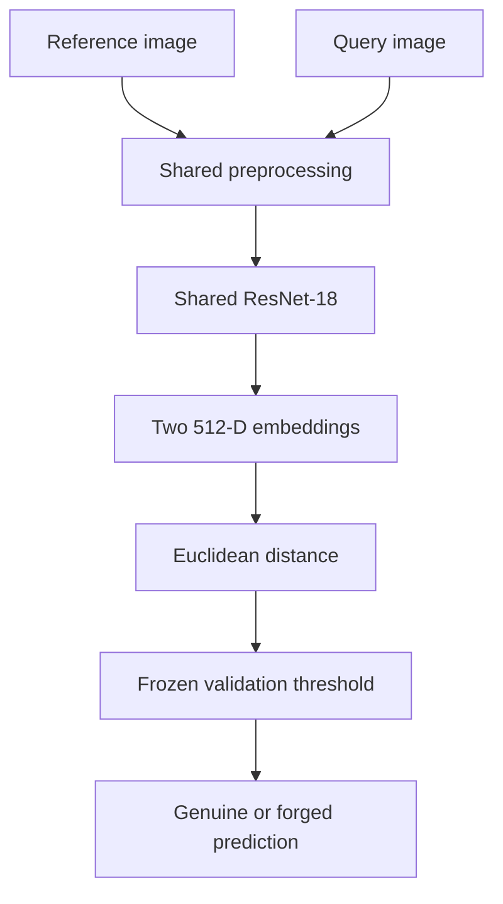
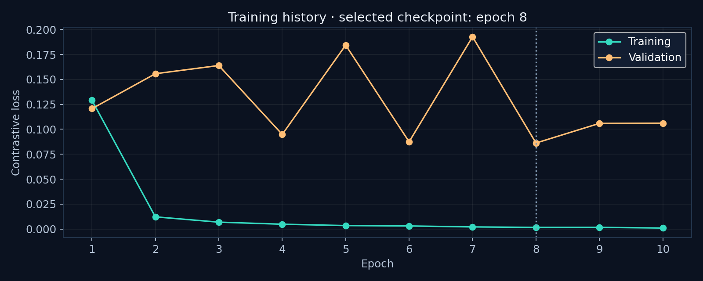

<p align="center"></p>

<p align="center">
  
  
  
  
</p>

<h3 align="center">Two signatures. One measured comparison.</h3>
<p align="center">An end-to-end deep learning project for offline handwritten signature verification.</p>

---

## What is DeepSVerify?

DeepSVerify compares a **genuine reference signature** with a **query signature** from the same claimed writer. A shared Siamese ResNet-18 embeds both images into 512 dimensions; Euclidean distance and a frozen validation threshold produce a genuine/forged prediction.

The interface offers a live comparison workspace, transparent distance/threshold output, measured dataset-wise results, and an explanation of the pipeline. It runs on CPU for deployment; training was performed separately on a Colab T4.

> **Research demo:** predictions are fallible. The baseline falsely rejected 13.12% of genuine test pairs and accepted 9.47% of forged test pairs. It is not an identity-authentication or forensic decision service. Distances are not confidence percentages.

## Measured results

Evaluation uses the selected checkpoint and **one threshold chosen on validation only: 0.4483108521**. The test split contains 25,768 pairs and 47 held-out writers.

| Dataset | Test pairs | Accuracy | False acceptance | False rejection | ROC-AUC |
|:--|--:|--:|--:|--:|--:|
| CEDAR | 4,416 | 86.41% | 1.13% | 26.04% | 0.9831 |
| BHSig260 Bengali | 8,124 | 92.12% | 6.70% | 9.06% | 0.9728 |
| BHSig260 Hindi | 13,228 | 87.37% | 13.96% | 11.31% | 0.9415 |
| **Overall** | **25,768** | **88.70%** | **9.47%** | **13.12%** | **0.9505** |

Overall precision: **90.17%** · recall: **86.88%** · F1: **88.49%** · empirical test EER: **10.52%**.

The positive class is genuine. Pairs reuse signatures and writers, so they are not independent people or independent acquisition events. Test EER is a diagnostic summary of the ROC curve, not the deployment threshold.

Source: [`results/test_metrics.json`](results/test_metrics.json). Validation summary: [`results/validation_summary.json`](results/validation_summary.json).

## How it works



1. Composite transparent images onto white and convert to grayscale.
2. Detect the foreground using Otsu, crop with a 10% bounding-box margin, and flatten the background.
3. Preserve aspect ratio while resizing and padding to **384 × 128**; scale pixels to **[0,1]**.
4. Encode both images with the same backbone and compare their embeddings.
5. Accept as genuine when distance is at or below the frozen threshold.

The deployment uses the original preprocessing source, verified against checkpoint provenance. Export removes optimizer/RNG state without changing model weights or the threshold.

## Training & reproducibility

| Setting | Baseline |
|:--|:--|
| Architecture | Siamese ResNet-18, 11,170,240 parameters |
| Input tensor | `[B, 1, 128, 384]` |
| Embedding | 512 dimensions, no embedding normalization |
| Loss | Contrastive, margin 1.0 |
| Pair labels | 1 = genuine/genuine; 0 = genuine/forgery |
| Optimizer | Adam, learning rate 0.0001 |
| Batch size / seed | 32 / 42 |
| Pretraining / augmentation | None / none |
| Epochs | 10; lowest validation loss at epoch 8 |
| Recorded epoch time total | 166.28 minutes; excludes setup and final evaluation |



The widening training/validation loss gap and fluctuating validation loss are limitations of this baseline. The selected checkpoint is the minimum-validation-loss checkpoint, not automatically the last epoch.

## Dataset protocol

- **16,680 images**, **315 writers**, **7,560 genuine**, **9,120 forgery**, as recorded in the original project metadata.
- Writer-disjoint train/validation/test assignment: **221 / 47 / 47 writers**.
- Existing pair files: **122,462 / 25,804 / 25,768 pairs**.
- References are genuine; queries are genuine or forged. No forgery/forgery pairs.
- Hindi writer 123 has no genuine samples, remains assigned to training and is excluded from pairing. Writer 124's additional genuine images are retained.
- Historical QC reports zero exact-duplicate groups crossing splits and 34 perceptual-hash groups crossing splits. Perceptual collisions are not automatically confirmed leakage; this remains a review limitation.

Raw datasets, signatures, personal uploads and machine-specific scored-pair paths are not distributed in this repository. Obtain the datasets separately under their applicable terms. Optional ablations have not been performed.

## Run locally

Use Python **3.12**. From the repository folder in Windows Command Prompt:

```cmd
py -3.12 -m venv .venv
.venv\Scripts\activate.bat
python -m pip install -r requirements.txt
python -m streamlit run streamlit_app.py
```

The app expects `models/best.pt` and `models/threshold.json`. A source-only package shows a setup message until the trained model is exported.

To export from your completed Windows demo, using its actual folder path:

```cmd
python scripts\export_deploy_model.py --source "C:\path\to\DeepSVerify\checkpoints\baseline_v1"
```

Only run the exporter on your trusted checkpoint. It verifies the source checkpoint/threshold and preprocessing hashes, then confirms exported weights are bit-identical. The original training checkpoint stays untouched.

## Publish on Streamlit Community Cloud

See **[DEPLOYMENT.md](DEPLOYMENT.md)** for public GitHub publishing and exact Streamlit settings.

| Setting | Value |
|:--|:--|
| Repository | Your public `DeepSVerify` repository |
| Branch | `main` |
| Main file | `streamlit_app.py` |
| Python | `3.12` |
| Secrets | None required by this app |

A live URL should only be added here after deployment succeeds. This source package does not claim an existing public deployment.

## Presentation guide

1. Introduce offline verification and the reference/query workflow.
2. Show a genuine pair and a forgery pair captured under similar conditions.
3. Explain the distance and frozen threshold rather than calling distance a probability.
4. Open **Measured results** and discuss dataset differences.
5. Demonstrate a failure case honestly: identical-image acceptance alone does not prove generalisation.

## Project layout

| Path | Purpose |
|:--|:--|
| `streamlit_app.py` | Public demonstration interface |
| `code/verification/` | Model, training, evaluation and inference |
| `code/preprocessing/` | Existing shared preprocessing |
| `code/splitting/`, `code/pairing/` | Existing writer and pair pipeline |
| `models/` | Compact trained deployment checkpoint |
| `results/` | Measured aggregate results and epoch history |
| `scripts/export_deploy_model.py` | Safe inference-only export |
| `tests/` | Pipeline and integration tests |

## Development tests

```cmd
python -m pip install -r requirements-dev.txt
set PYTHONPATH=code;.
python -m pytest tests code/preprocessing/test_duplicate_audit.py code/preprocessing/test_eda.py -q
```

The original completion workflow passed 207 tests before deployment-specific changes. Synthetic integration fixtures test software behaviour; they are not dataset evaluation results.

## Privacy & limitations

Uploaded images are processed using temporary files which the application deletes after comparison. The application does not intentionally persist uploads or add them to training data. Hosting-provider handling and browser/session memory are separate from this application behaviour.

This baseline is sensitive to differences in lighting, crop, writing thickness and capture conditions. It uses a single reference and a shared threshold across datasets. Deployment improves access, not model accuracy. No real-world reliability, legal authenticity or production-security claim is made.

## References

- [PyTorch ResNet-18 implementation](https://docs.pytorch.org/vision/stable/models/generated/torchvision.models.resnet18.html)
- [Streamlit deployment documentation](https://docs.streamlit.io/deploy/streamlit-community-cloud/deploy-your-app/deploy)
- [GitHub large-file guidance](https://docs.github.com/en/repositories/working-with-files/managing-large-files/about-large-files-on-github)
